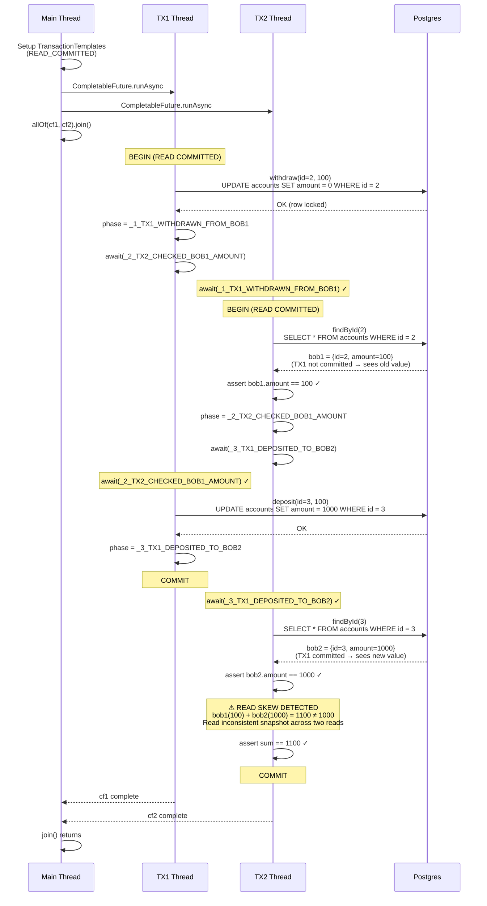

# Read Skew under READ COMMITTED isolation

## Initial state
| id | owner | amount |
|----|-------|--------|
| 1  | alice | 1000   |
| 2  | bob   | 100    |
| 3  | bob   | 900    |

Bob's total across accounts 2 & 3 = **1000**

## Sequence Diagram

## Explanation

**Read skew** occurs when a transaction reads two related pieces of data at different points in time
and sees an inconsistent state because another transaction modified and committed changes between the two reads.

Under **READ COMMITTED**, each `SELECT` sees the latest *committed* data at the moment it executes.
This means two reads within the same transaction can see data from different committed snapshots:

1. **TX2 reads account 2** → TX1 has not committed yet → sees old value **100**
2. **TX1 commits** (withdrew 100 from account 2, deposited 100 to account 3)
3. **TX2 reads account 3** → TX1 has committed → sees new value **1000**
4. **TX2 sees total = 1100** instead of the correct **1000** — a read skew anomaly

This anomaly is prevented under **REPEATABLE READ** or **SERIALIZABLE** isolation levels,
where TX2 would see a consistent snapshot throughout its entire transaction.

