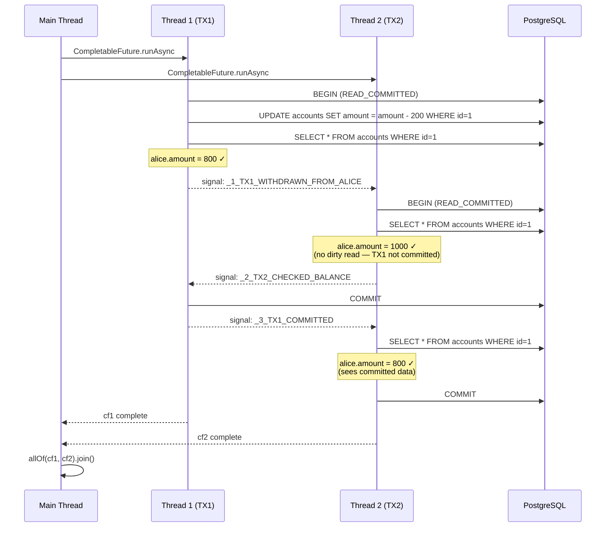
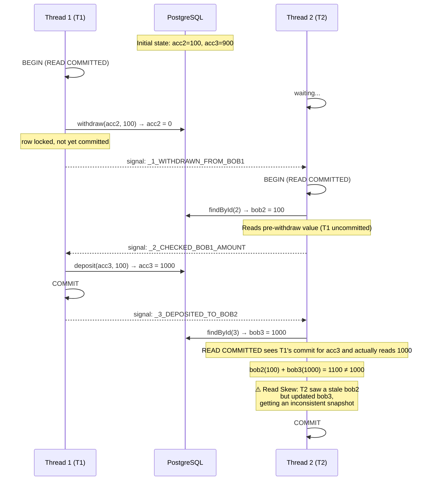
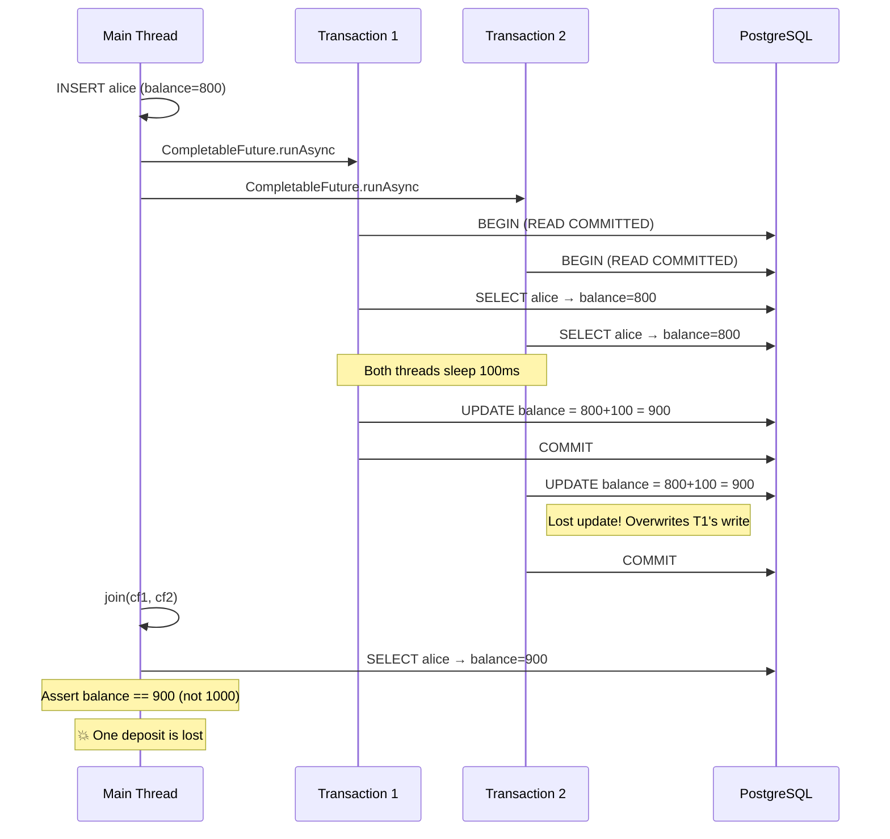

### No dirty reads

### Read skew
Both reads are correct separately, but we get an incorrect result in total. 

What's happening: 
1. T1 begins and withdraws 100 from account 2 (but hasn't committed yet).  
2. T2 reads account 2 — since T1 hasn't committed, READ COMMITTED returns the old value (100).  
3. T1 then deposits 100 into account 3 and commits. 
4. T2 now reads account 3. Under READ COMMITTED, each statement sees the latest committed data, so T2 could see 1000, and the sum is 1100 instead of the correct total of 1000.  
This is the read skew anomaly: T2's two reads happen at different points in time relative to T1's commit, yielding an inconsistent view of the data. A higher isolation level (e.g., REPEATABLE READ) would prevent this. 

### Lost update
